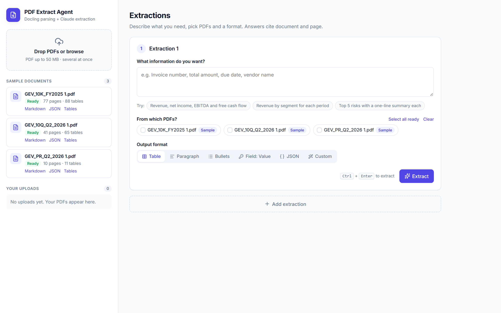
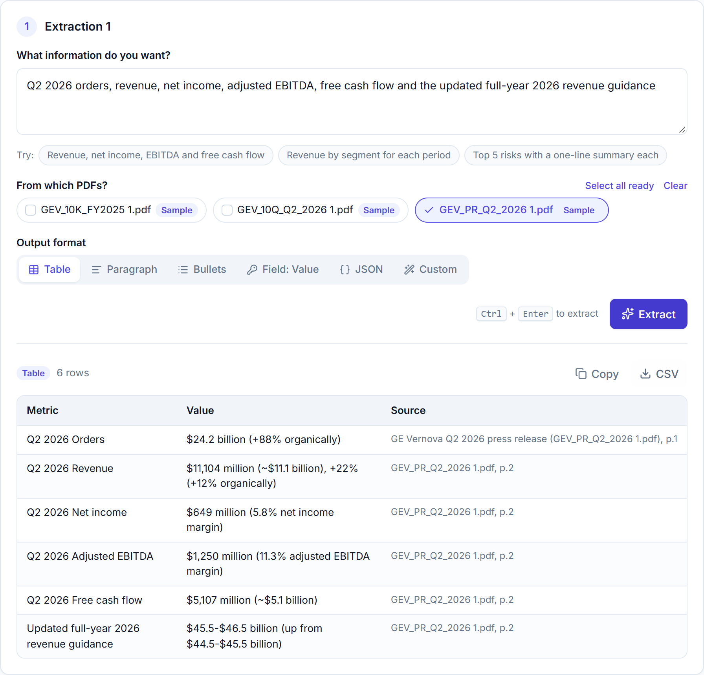
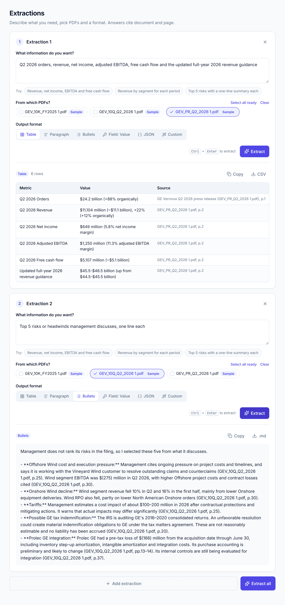
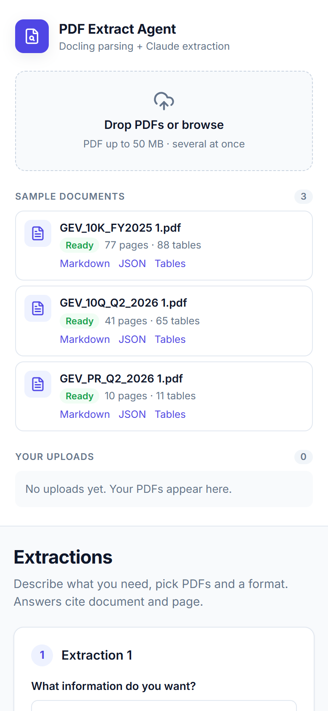
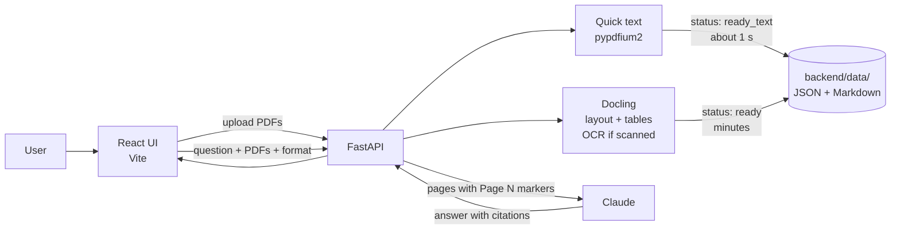

# PDF Extract Agent

Upload PDFs, describe the information you need in plain English, and get it back as a **table, paragraph, bullet list, Field: Value list or JSON**, with every answer citing **document name and page**. If something is not in the documents, the agent says `Not found` instead of guessing.

Built with **React + FastAPI + [Docling](https://github.com/docling-project/docling) + Claude**. Three public SEC filings from GE Vernova ship in [`samples/`](samples/) so you can try it right away.



---

## Table of contents
- [Features](#features)
- [Screenshots](#screenshots)
- [How it works](#how-it-works)
- [Sample documents](#sample-documents)
- [Quick start](#quick-start)
- [Configuration](#configuration)
- [API reference](#api-reference)
- [Performance](#performance)
- [Project structure](#project-structure)
- [Limitations and security](#limitations-and-security)
- [Roadmap](#roadmap)

---

## Features

- **Ask in plain English.** "Q2 revenue, net income and free cash flow" or "Top 5 risks, one line each".
- **Six output formats:** Table, Paragraph, Bullets, Field: Value, JSON or a custom format you describe.
- **Citations on every answer** (`document.pdf, p.N`) and `Not found` for anything missing.
- **Multiple extractions at once.** Each card has its own question, PDFs and format; run them one by one or with **Extract all**.
- **Usable in about 1 second.** A PDF can be queried right after upload using its text layer, while Docling builds full layout and table structure in the background.
- **Real table parsing** with Docling (TableFormer). Export each document as Markdown, Docling JSON or table rows.
- **OCR only when needed.** Scanned PDFs get OCR; PDFs with a text layer skip it (identical output, about 2x faster).
- **Preloaded samples** that are parsed once at startup, plus your own uploads.
- **Copy and download** results as CSV, JSON or Markdown.
- **Clean light UI:** status pills, drag-and-drop upload, toggle chips, toasts, `Ctrl + Enter` to extract, responsive layout.

## Screenshots

**Table extraction with page citations**



**Several extractions on different documents and formats**



<details>
<summary><b>Mobile layout</b></summary>



</details>

## How it works



1. **Upload.** The backend validates every file first (`.pdf`, starts with `%PDF`, 50 MB max), so one bad file never leaves others half-saved.
2. **Quick text (under 1 s).** `pypdfium2` reads each page's text layer and saves it. The document becomes `ready_text` and can already answer questions.
3. **Docling parse (background).** Docling builds layout-aware Markdown for every page and real table rows, then the document becomes `ready`. Only one Docling parse runs at a time, using all CPU cores.
4. **Extract.** Your instruction and the selected documents' pages, each marked `[Page N]`, go to Claude in one request. The system prompt requires page citations and `Not found` for missing data.
5. **Answer.** Tables are returned as JSON (`columns` + `rows`, with a `Source` column) and rendered in the UI; other formats come back as text.

**Document status:** `processing` → `ready_text` (quick text, extract works) → `ready` (full Docling parse). Scanned PDFs skip `ready_text` and wait for OCR. Parses interrupted by a restart resume or are marked as errors with a **Retry** button.

## Sample documents

| File | What it is | Pages | Tables |
|---|---|---|---|
| [`GEV_10K_FY2025 1.pdf`](samples/) | GE Vernova annual report (Form 10-K), FY2025 | 77 | 88 |
| [`GEV_10Q_Q2_2026 1.pdf`](samples/) | GE Vernova quarterly report (Form 10-Q), Q2 2026 | 41 | 65 |
| [`GEV_PR_Q2_2026 1.pdf`](samples/) | GE Vernova Q2 2026 earnings press release | 10 | 11 |

These are public SEC filings, chosen because they are dense with financial tables. Every PDF in `samples/` is registered automatically when the backend starts, parsed **once**, and kept on disk. Samples cannot be deleted from the UI. To add your own demo documents, drop PDFs into `samples/` and restart the backend.

Try these prompts:
- *Press release:* "Q2 2026 orders, revenue, net income, adjusted EBITDA and free cash flow" (Table)
- *10-Q:* "Revenue by segment for each period" (Table)
- *10-K:* "Top 5 risks with a one-line summary each" (Bullets)

## Quick start

**Requirements:** Python 3.11 (3.10+ works), Node 18+, an [Anthropic API key](https://console.anthropic.com/). No GPU needed.

### 1. Backend

```bash
cd backend
python -m venv .venv
.venv\Scripts\activate            # macOS/Linux: source .venv/bin/activate
pip install -r requirements.txt   # Docling pulls in PyTorch: large download
copy .env.example .env            # macOS/Linux: cp .env.example .env
# edit .env and set ANTHROPIC_API_KEY
uvicorn main:app --port 8000
```

The first start downloads Docling's models and parses the three samples (about 20 minutes on an 8-core CPU). The samples can be queried with quick text within seconds, and later starts are instant.

### 2. Frontend

```bash
cd frontend
npm install
npm run dev
```

Open **http://localhost:5173**. API docs are at http://localhost:8000/docs.

### 3. Check a parse from the command line (optional)

```bash
cd backend
python scripts/try_parse.py "../samples/GEV_PR_Q2_2026 1.pdf"
```

Prints parse time, page count, table count and the first 500 characters of page 1.

## Configuration

Backend settings live in `backend/.env` (loaded with `python-dotenv`). Never commit `.env`; it is git-ignored.

| Variable | Default | Purpose |
|---|---|---|
| `ANTHROPIC_API_KEY` | *(required)* | Claude API access |
| `CLAUDE_MODEL` | `claude-sonnet-5-5` | Model used for extraction |
| `MAX_CONTEXT_CHARS` | `400000` | Maximum characters of document text sent per request; the UI warns when documents are truncated |

Frontend: set `VITE_API_URL` (default `http://localhost:8000`) to point the UI at another backend.

## API reference

| Method | Endpoint | Purpose |
|---|---|---|
| `POST` | `/documents` | Upload one or more PDFs (multipart `files`). Returns `[{id, name, status}]` |
| `GET` | `/documents` | List documents (samples first) |
| `GET` | `/documents/{id}` | One document's metadata |
| `POST` | `/documents/{id}/retry` | Re-parse a failed document |
| `DELETE` | `/documents/{id}` | Delete an uploaded document (samples return 403) |
| `GET` | `/documents/{id}/export?format=markdown\|json\|tables` | Download Docling output (when `ready`) |
| `POST` | `/extract` | Run an extraction |

`POST /extract` body:

```json
{
  "doc_ids": ["70eb517295f8"],
  "instruction": "Revenue by segment for each period",
  "format": "table",
  "custom_format": ""
}
```

Response: `{format, text, truncated, output_truncated, warning?, data?}`. For `table`, `data` is `{columns, rows}`; for `json`, `data` is the parsed JSON. Claude API errors map to `429` (rate limit), `401` (bad key) or `502` (other).

## Performance

Measured on a CPU-only laptop (8 cores, no GPU):

| Document | Pages | Before tuning | Full Docling parse | Usable for questions |
|---|---|---|---|---|
| Q2 2026 press release | 10 | 258 s | 116 s | 0.8 s |
| Q2 2026 10-Q | 41 | ~18 min (est.) | 9.3 min | ~1 s |
| FY2025 10-K | 77 | ~33 min (est.) | 11.6 min | ~1 s |

Gains came from skipping OCR for PDFs with a text layer (output was byte-identical), using all CPU cores, turning off unused Docling features (image generation, picture and code/formula enrichment), and the quick-text path. A test of Docling's `FAST` table mode on the 10-Q's financial statements matched `ACCURATE` on every number at about 2x the speed; it is not enabled yet.

## Project structure

```
.
├── backend/
│   ├── main.py              FastAPI app: endpoints, upload validation, two-stage parsing, storage
│   ├── parser.py            Docling + pypdfium2: quick text, per-page Markdown, tables
│   ├── extract.py           Prompt building and the Claude call
│   ├── scripts/try_parse.py Command-line parse check
│   ├── requirements.txt
│   └── .env.example
├── frontend/
│   └── src/
│       ├── App.jsx          State, polling, API calls
│       ├── api.js           All HTTP calls
│       ├── utils.js         Status helpers, CSV and download helpers
│       ├── components/      Sidebar, DocItem, ExtractionCard, Result, Toast
│       └── styles.css       Light theme (design tokens)
├── samples/                 Preloaded GE Vernova filings
├── docs/screenshots/        Images used in this README
└── PLAN.md                  Phased roadmap and design decisions
```

Parsed data is stored per document in `backend/data/<id>/` (`source.pdf`, `meta.json`, `pages.json`, `tables.json`, `doc.md`, `doc.json`). It is git-ignored.

## Limitations and security

This is a **proof of concept for local use**.

- **No authentication or rate limiting.** Anyone who can reach the backend can read and delete documents and spend API credits. Do not expose port 8000 publicly until auth is added.
- **Single process.** Parsing runs in background threads inside the API server; run one uvicorn worker.
- **Whole documents are sent to Claude** (up to `MAX_CONTEXT_CHARS`). Very long documents are truncated; retrieval is on the roadmap.
- **Quick-text answers** (before Docling finishes) flatten table columns, so the UI warns that table values may be less reliable.
- **Prompt injection:** document text goes into the prompt, so a crafted PDF could influence its own extraction.
- CORS allows `http://localhost:5173` only.

## Roadmap

See [PLAN.md](PLAN.md) for details.

- [ ] Enable Docling `FAST` table mode (about 2x faster on table-heavy filings)
- [ ] Automated tests (pytest) and CI
- [ ] Verify OCR with a scanned PDF
- [ ] Authentication, per-user documents and rate limiting
- [ ] MongoDB for documents and extraction history
- [ ] Streaming answers and retrieval for very long documents
- [ ] Docker images and deployment guide
